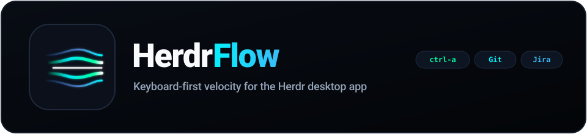
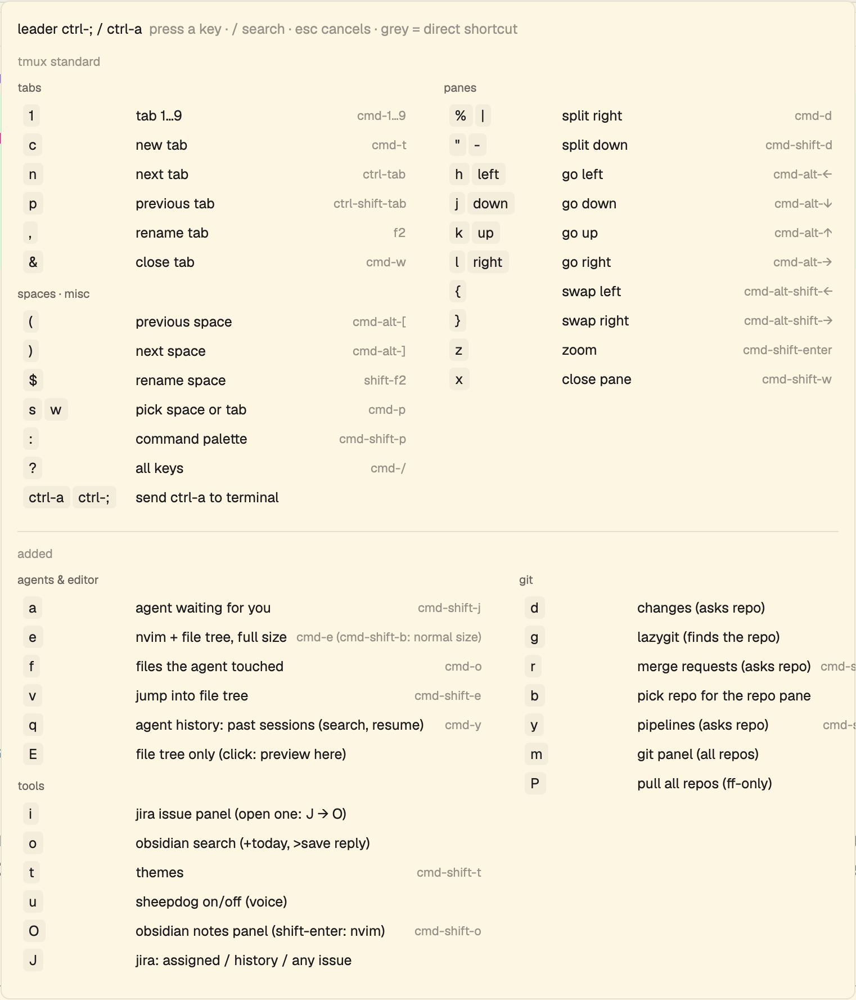
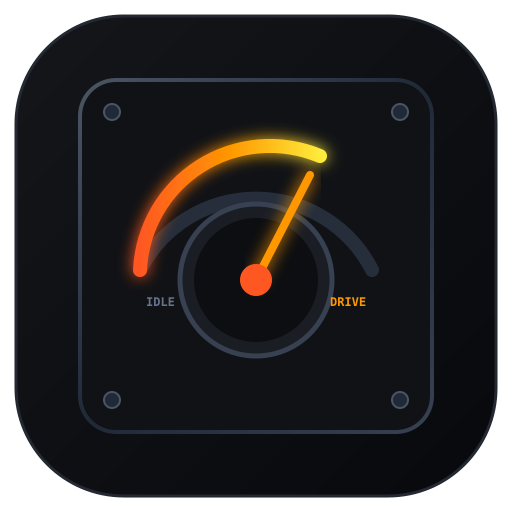
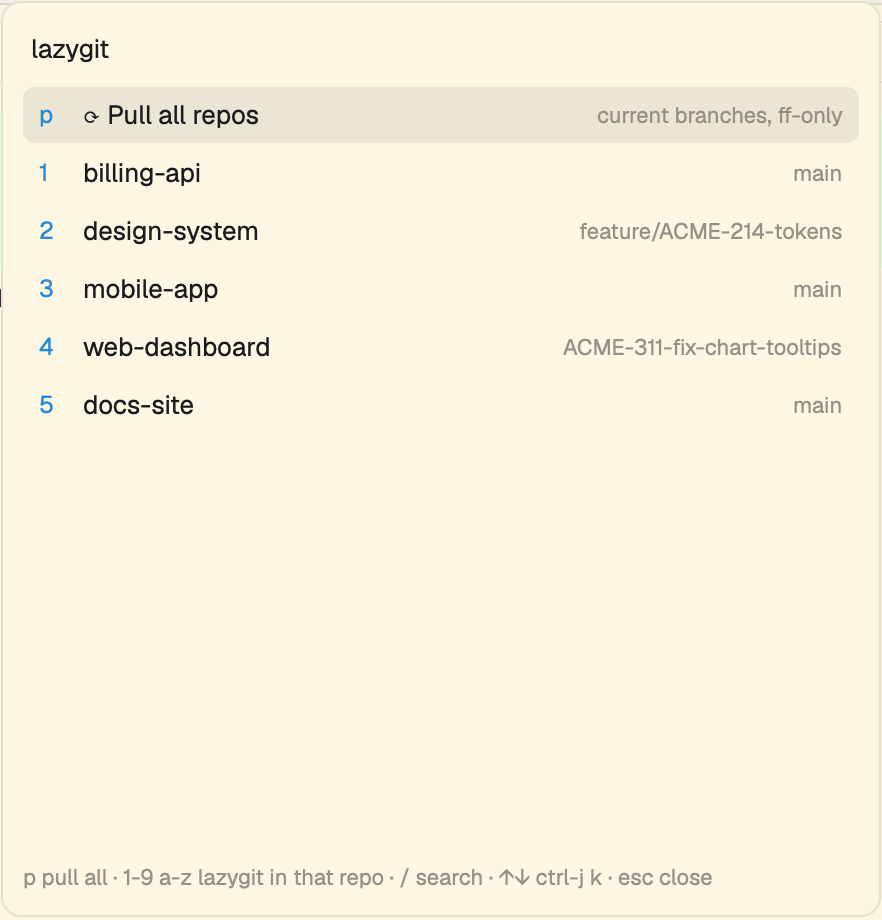
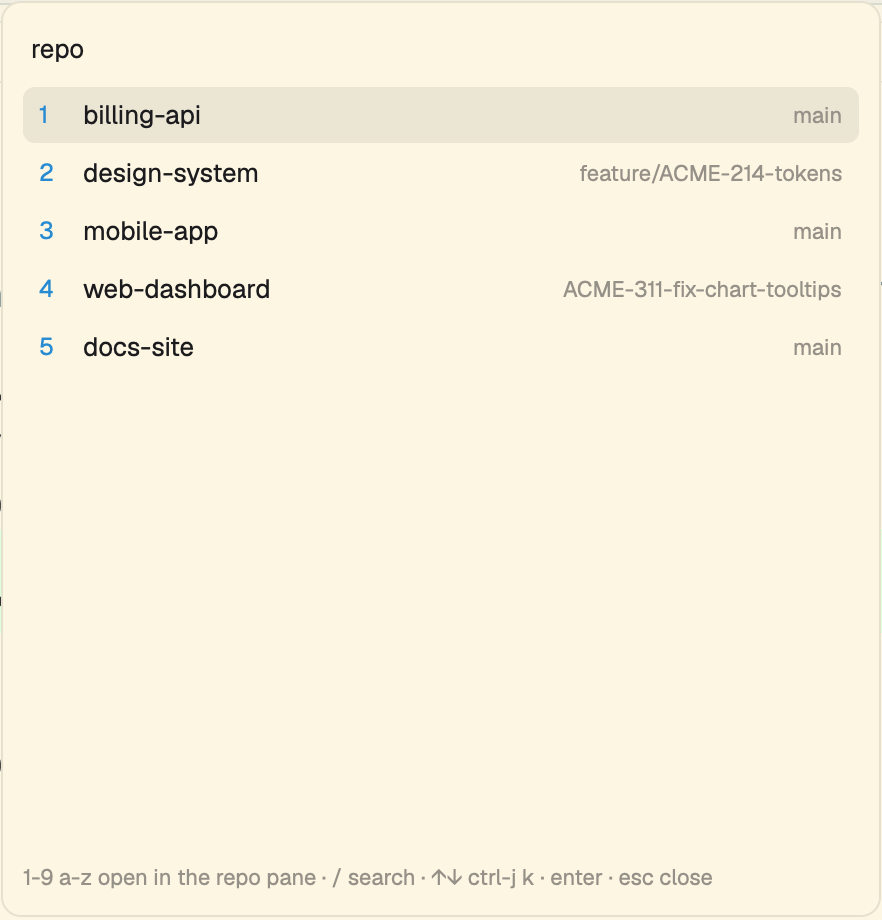
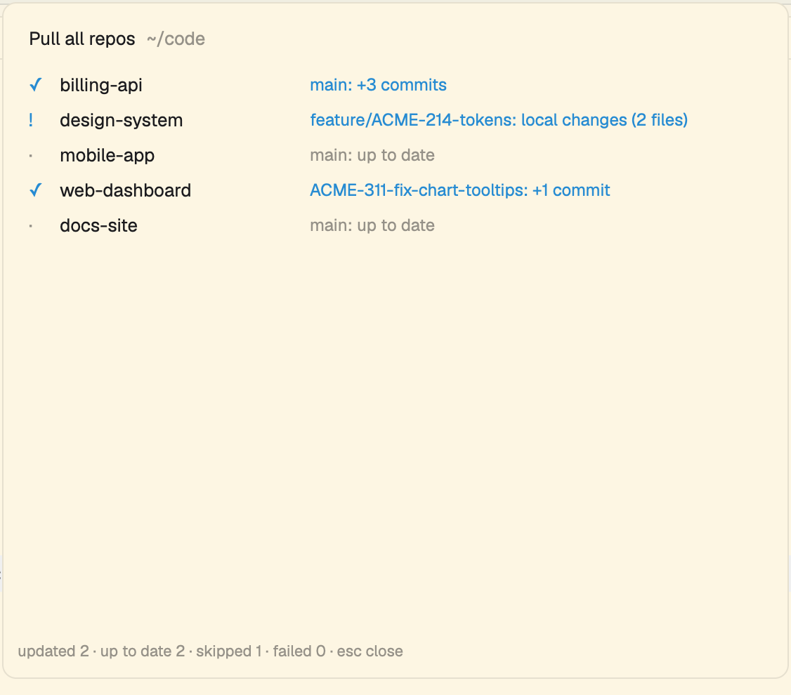
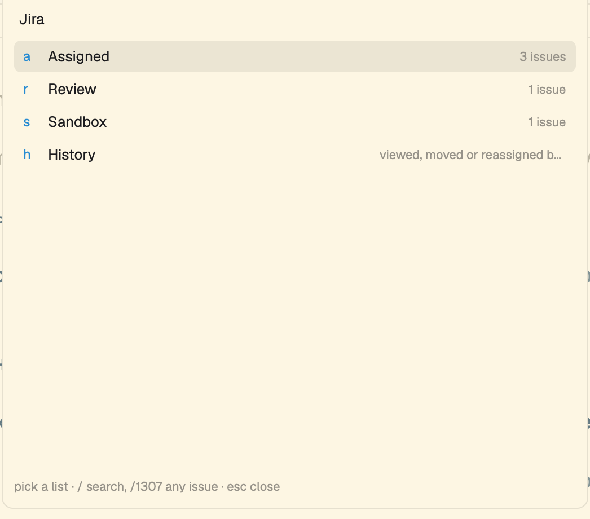
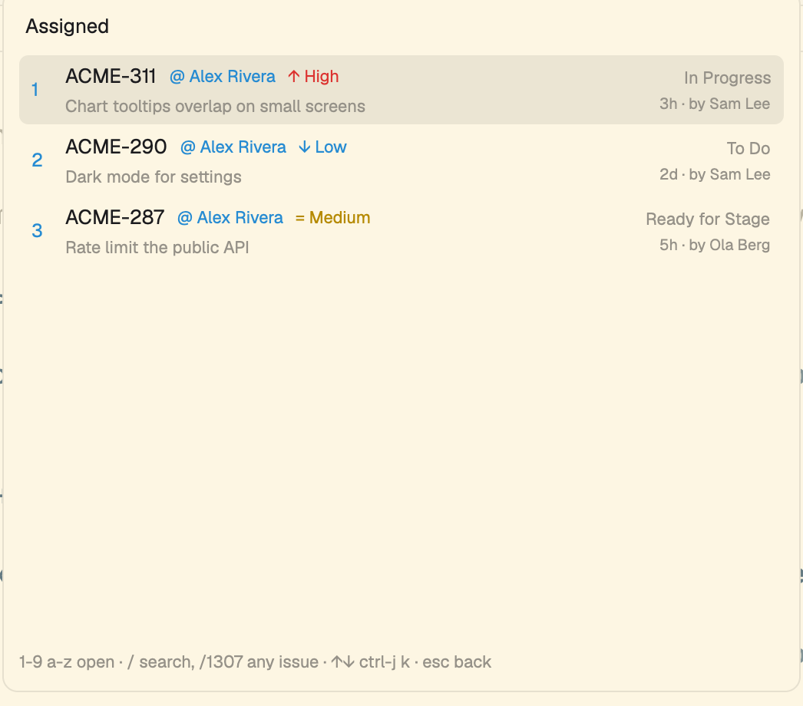
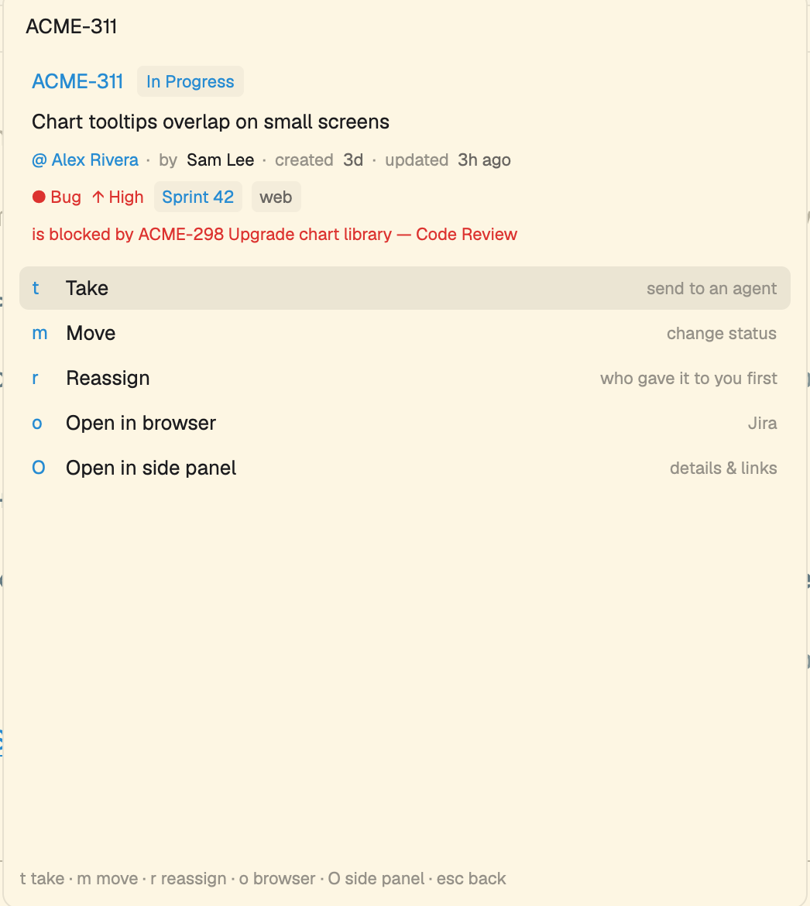
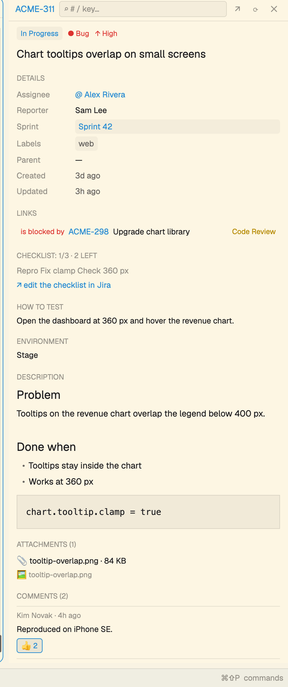

<p align="center">
  
</p>

# HerdrFlow

Keyboard-first velocity tools for the [Herdr](https://herdr.dev) desktop app, in one mod:

- **Leader** — `ctrl-a` / `ctrl-;` then one key, with a cheat sheet.
- **Git & repos** — pick a repo for the helper shell and panels, lazygit, pull all repos safely.
- **Jira** — your issues, configurable counters, top bar badges, live issue card, quick reassign / move / hand to an agent, and a side panel with inline editing and `+ Context`.
- **Bot sessions** — auto-saves open agent sessions across Herdr restarts and restores them into matching panes on startup.

Every list shows its key on the left, `/` searches, the footer lists the keys, and the Russian
keyboard layout works too.



_Repos, issues and people on the screenshots are invented._

## Leader



`ctrl-a` or `ctrl-;` opens a popup with the cheat sheet; the next key runs its action and closes it.
The top block is the tmux set (`c n p 1-9 , & % " h j k l { } z x ( ) $ s w : ?`, plus `-` / `|`
splits), the bottom block is ours. Direct shortcuts work outside the leader too (grey column):
`alt-h/j/k/l` (`cmd-alt-←/↓/↑/→`) to focus panes, `alt-shift-h/k` & `alt-shift-l/j` (`cmd-alt-shift-←/→`)
to swap panes. Pressing the leader twice sends it to the terminal. `/` searches the sheet.

| Key | What |
|---|---|
| `h` / `j` / `k` / `l` | focus pane left / down / up / right (`alt-h/j/k/l`, `cmd-alt-←/↓/↑/→`) |
| `{` / `}` | swap panes left / up & right / down (`alt-shift-h/k/l/j`, `cmd-alt-shift-←/→`) |
| `g` | lazygit for the right repo |
| `b` | repo picker (cd the tab's helper shell into a repo) |
| `d` / `r` / `y` | Changes / Redline / Pipelines for a repo (asks which one first) |
| `P` | pull all repos |
| `J` | jira: assigned / review / history / any issue |
| `i` | Jira side panel |
| `e` | nvim + file tree, nvim zoomed (needs herdr-nvim) |
| `G` | git panel · `q` agent history · `o` / `O` Obsidian · `t` themes · `a` agent waiting |

Rows for mods you don't have (herdr-nvim, Redline, Obsidian, Sheepdog, Agent History…)
are hidden.

**Your own keys:** put rows in `~/.config/herdr-app/herdr-flow.bindings.json`, same format as
`mod/leader/bindings.json` (`"key": [action, label, direct shortcut, section]`); `null` removes a
key. Updates of the mod never touch this file.

Actions: an app command (`tab.new`, `tab.select:1`), a mod command (`cloudflare-deploys.open`),
`screen:<git|repo|pull|jira>`, `panel:<id>` (a side-panel child), `repo:<action>` (pick a repo
first), `send-key`, `nvim-zoom`, `sheepdog-toggle`.

## Git & repos

 



**Where the repos are.** The active space's folder: if it is a git repo, that repo; otherwise every
repo directly inside it (one level), e.g. a `~/code` folder with several projects.

- **Repo picker** (`ctrl-a b`): repos with their branch. Picking one cd's the tab's helper shell
  (made beside your pane the first time) and focuses it, so Herdr's Changes / Redline / Pipelines
  follow that repo.
- **lazygit** (`ctrl-a g`): the focused terminal's repo (or nvim's folder) opens lazygit in a new
  tab right away; otherwise the list. `p` = Pull all.
- **Pull all** (`ctrl-a P`): every repo, 4 at a time, `git pull --ff-only` only — never a merge or
  rebase, so it can't create conflicts. Skipped, with the reason: local changes, no upstream,
  detached HEAD, merge/rebase in progress, a branch that diverged. Git never prompts.

## Jira

 

`ctrl-a J` opens the Jira hub:

- Configurable counter lists: `a` **Assigned** (open issues on you; current branch issue first),
  `r` **Review**, plus custom lists like `s` **Sandbox**.
- `h` **History** — issues you viewed, moved or reassigned in the last 14 days.
- `/1307` or `/KEY-1307` — any issue by key or summary. A bare number uses the current branch's project,
  else your usual one.

### Configurable counters & top bar badges

Customize your counters in `~/.config/herdr-app/herdr-flow.jira.json` with custom `jql`, `color`
(`accent`, `warn`, `ok`, `muted`), and `notify` toast alerts. Pass either a list of counters or an object with `"counters"` and optional `"fields"` to pin editable custom fields in the side panel's `Details`:

```json
{
  "counters": [
    {
      "id": "assigned",
      "tag": "A",
      "key": "a",
      "label": "Assigned",
      "jql": "assignee = currentUser() AND statusCategory != Done AND status != Reject AND status not in (\"Code Review\", \"Review\", \"In Review\") ORDER BY updated DESC",
      "color": "accent",
      "notify": { "title": "Jira [A] · Assigned to you", "level": "info" }
    },
    {
      "id": "review",
      "tag": "R",
      "key": "r",
      "label": "Ready for Review",
      "jql": "assignee = currentUser() AND status in (\"Code Review\", \"Review\", \"In Review\") ORDER BY updated DESC",
      "color": "warn",
      "notify": { "title": "Jira [R] · Ready for your code review", "level": "warning" }
    },
    {
      "id": "sandbox",
      "tag": "S",
      "key": "s",
      "label": "Sandbox Tasks",
      "jql": "project = ACME AND status = Open AND assignee is EMPTY ORDER BY created DESC",
      "color": "ok",
      "notify": { "title": "Jira [S] · New free task in Sandbox", "level": "success" }
    }
  ],
  "fields": [
    { "name": "Due date Code review", "type": "date" }
  ]
}
```

- **Pinned custom fields (`fields`)**: add optional field definitions alongside `"counters"` so custom fields (even when empty or `null` in Jira) are always pinned and editable in the side panel's `Details` section.

- **Top-bar widget (`jira-bar`)**: add the optional `jira-bar` block (`props: { view: "bar" }`, snippet in
  `scripts/layout-snippets.json`) to your layout's top bar tabs row. It shows live `A` / `R` / `S` counts,
  opens that list on click, and polls in the background.
- **Desktop toasts**: when new issues arrive on any monitored counter, Herdr posts a toast notification
  with the issue key and summary (suppressed on initial startup, bundled if multiple arrive). Set
  `"notify": false` on any counter to silence its alerts.

### Issue card & actions

Picking an issue displays its card preview: semantic status pill, priority icon and color
(⇈ Highest, ↑ High, = Medium, ↓ Low, ⇊ Lowest), issue type icon and color (● Bug, ◈ Story, ⚡ Epic, ✓ Task),
`@ Assignee`, sprint chip, label chips, parent, and red links (blocks / is blocked by).

| Key | What |
|---|---|
| `c` | **Context**: paste issue context into the active agent's input line without submitting (no Enter), so you can review and keep typing before sending |
| `t` | **Take**: start an agent (a new tab with any installed agent, or the agent in your pane) with the issue text: analyze it, find the repo, update the main branch, create a branch by the project's rules (AGENTS.md / CLAUDE.md / `.claude/commands`, else like existing branches), plan before coding |
| `m` | **Move**: change status (only the transitions Jira allows), then offers Reassign |
| `r` | **Reassign**: whoever handed it to you first (from the issue history), the reporter, or search |
| `o` | open in the browser |
| `O` | open in the **side panel** |

 

### Side panel (`jira-view`)

The **side panel** (`ctrl-a i` or `O` on any card) docks alongside your work:

- **`+ Context` button** in the top badge row: pastes the current issue's prompt (`agentPrompt`: key, summary, status, link, description, and branch instructions) directly into the active agent's prompt without submitting, or opens an inline picker to choose an agent / start a new tab with the context placed in the clipboard.
- **Inline editing right in the side panel**:
  - Click the **Status badge** (`In Progress ▾`) to view and apply Jira transitions in place.
  - Click **`Assignee`** (`@ Name ✎`) in `Details` to reassign (with quick options for the person who handed the issue over, the reporter, or live user search).
  - Click any configured **pinned field** (such as **`Due date Code review`**) in `Details` to set or clear a date using one-click chips (`Today`, `Tomorrow`, `+2d`, `Next Mon`, `Clear`) or by typing `YYYY-MM-DD` / `DD.MM`.
- **Quick issue switcher**: press `/` or click the `# / key` input in the header to switch to any issue
  instantly.
- **Header controls**: `←` back button with full history navigation, `↗` open in browser, `⟳` reload, and `✕` close.
- **Comment reactions**: comments display Jira `👍` reaction counts and allow toggling `👍` directly from the side panel.
- **Full issue details**: description and comments with rendered inline images, every filled custom field
  (How to test, Environment…), issue links (clicking any link opens that issue directly in the panel),
  attachments, and checklist progress summary. Images are cached locally in `~/.config/herdr-app/data/herdr-flow/cache`.

### Jira login

Create an API token at <https://id.atlassian.com/manage-profile/security/api-tokens>, then:

```sh
cat > ~/.config/herdr-app/herdr-flow.netrc <<'NETRC'
machine your-site.atlassian.net
login you@example.com
password YOUR_API_TOKEN
NETRC
chmod 600 ~/.config/herdr-app/herdr-flow.netrc
```

The site address comes from `machine`. The file is a secret: it stays outside the mod folder and
never goes into this repo.

## Install

Tell your agent:

```
Read ~/.config/herdr-app/AGENTS.md, then add this mod: github.com/F-y-o-d-o-r/herdr-flow
```

Or by hand, from a clone of this repo:

```sh
git clone https://github.com/F-y-o-d-o-r/herdr-flow.git && cd herdr-flow
sh scripts/install.sh
```

It copies `mod/` to `~/.config/herdr-app/mods/herdr-flow` (or `$HERDR_APP_HOME`), points
`ctrl-a` / `ctrl-;` at it when they are free, and offers optional layout blocks for your own
layout (`scripts/layout-snippets.json`):

- **router** — an invisible floating block (`props: { role: "router" }`, snippet in
  `scripts/layout-snippets.json`). Herdr's `keys.json` can only open a mod as a whole, so a direct key
  for one action inside herdr-flow needs it, e.g. `"cmd-e": "herdr-flow.nvim-zoom"`. Commands: `nvim-zoom`,
  `leader`, `git`, `repo`, `pull`, `jira`, `panel`, `card:<KEY>`, `list:<id>`, `show:<KEY>`, `bots-save`,
  `bots-restore`.
  The router also automatically preserves running bot sessions across Herdr restarts: every 5 seconds it
  snapshots active agent sessions into `~/.config/herdr-app/data/herdr-flow/bots-session.json`, and on Herdr
  launch (1.5s delay) matches candidate shell panes by pane ID, tab, and directory to relaunch your agents.
- **jira-view** — the Jira side panel (`props: { view: "panel" }`).
- **jira-bar** — top-bar badge counters (`props: { view: "bar" }`) with live issue counts and background new-issue toast alerts.

Run it again to update; your `herdr-flow.bindings.json`, `herdr-flow.jira.json`, and `herdr-flow.netrc` stay as they are.

**Needs:** Herdr app 0.1.14+, git, curl; lazygit for `g`; herdr-nvim for `e`.

## Develop

```sh
yarn install
yarn lint    # ESLint + Prettier, 0 errors / 0 warnings
yarn typecheck  # TypeScript checks the JavaScript (JSDoc types), 0 errors
yarn test    # node --test on the pure logic in tests/
yarn check   # herdr-app check mod
```

Plain JavaScript with JSDoc types, no build step. See `AGENTS.md` for the rules.

## Contact

<hello@ititi.dev>

## License

MIT. The leader screen started as a fork of `mods/prefix` from
[DanielFGray/herdr-config](https://github.com/DanielFGray/herdr-config) (Apache-2.0), see `NOTICE`.
